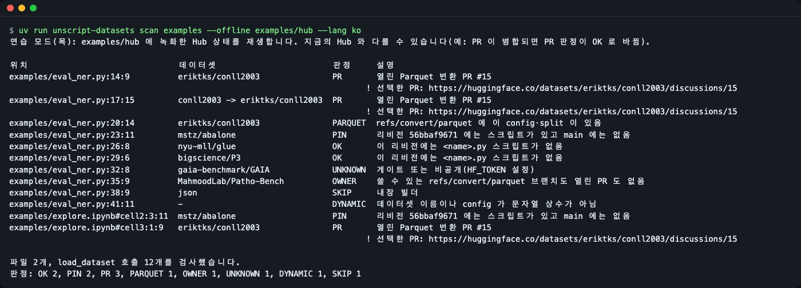
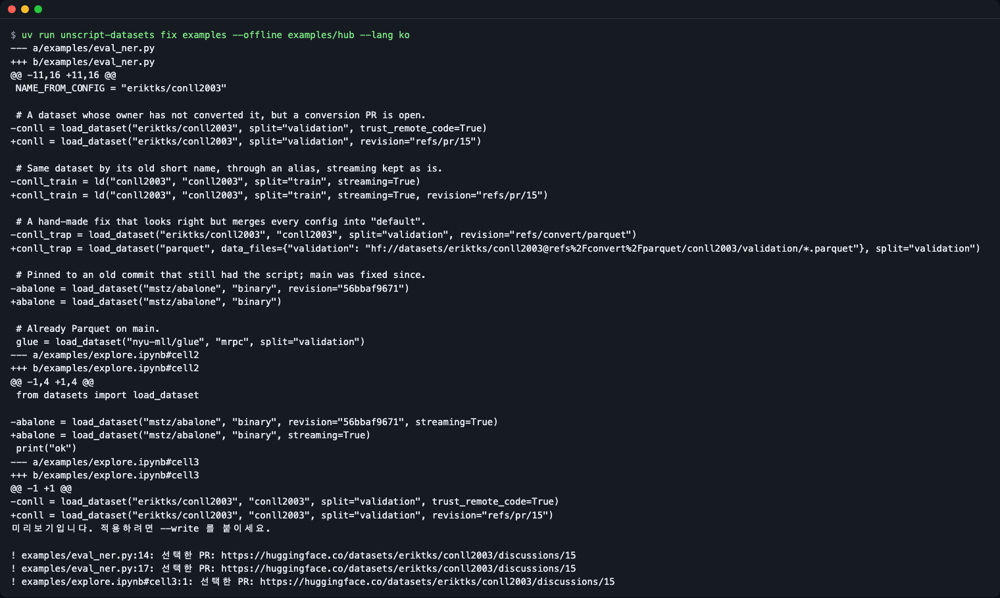
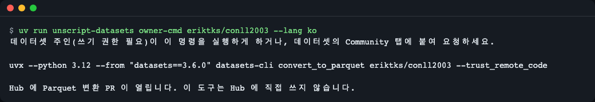
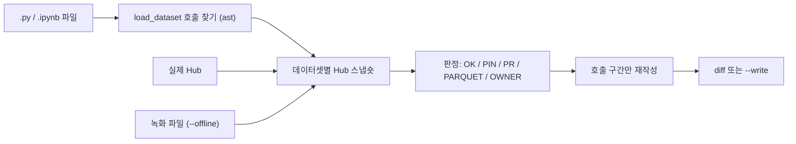

# unscript-datasets

[English](README.md) | **한국어**

`datasets` 를 4.x 로 올린 뒤 노트북이나 평가 스크립트가 `RuntimeError: Dataset scripts are no longer supported, but found <name>.py` 로 멈췄나요? `unscript-datasets` 는 `.py`·`.ipynb` 파일의 `load_dataset` 호출을 찾아, 각 데이터셋이 Hugging Face Hub 에서 지금 어떤 상태인지 확인하고, 그 데이터셋을 실제로 불러올 수 있는 방식으로 깨진 호출을 고쳐 씁니다. config·split 이름은 그대로 유지하고, 같은 입력에는 항상 같은 결과가 나옵니다.


*연습용 목(mock) 모드의 `scan`: 모든 `load_dataset` 호출에 PR, PARQUET, PIN, OK, OWNER, UNKNOWN 같은 판정이 붙습니다.*

## 이런 분께
- `datasets` 를 올린 뒤 노트북·평가 스크립트·CI 가 `load_dataset(...)` 에서 실패하는 분
- 저장소에 `load_dataset` 호출이 수십 개라 데이터셋마다 Hub 페이지를 일일이 확인하기 싫은 분
- 데이터셋 주인으로서 Parquet 으로 바꾸는 정확한 명령이 필요한 분

## 설치
```bash
# uv (https://docs.astral.sh/uv/): curl -LsSf https://astral.sh/uv/install.sh | sh
uv tool install git+https://github.com/LeeGyeongPil/unscript-datasets
```
Python 3.10 이상이 필요합니다. 실행 의존성은 `huggingface_hub` 하나이고, `datasets` 자체는 필요 없습니다.

clone 해서 써 보려면:
```bash
git clone https://github.com/LeeGyeongPil/unscript-datasets
cd unscript-datasets
uv sync
```
(아래 명령 앞에 `uv run` 을 붙입니다.)

## 빠르게 시작하기
연습용 목(mock) 모드입니다. 네트워크 대신 `examples/hub` 에 녹화해 둔 Hub 상태를 재생하므로 어느 컴퓨터에서든 결과가 같습니다.
```bash
uv run unscript-datasets scan examples --offline examples/hub --lang ko
```
```text
연습 모드(목): examples/hub 에 녹화한 Hub 상태를 재생합니다. 지금의 Hub 와 다를 수 있습니다(예: PR 이 병합되면 PR 판정이 OK 로 바뀜).

위치                               데이터셋                        판정     설명
examples/eval_ner.py:14:9          eriktks/conll2003               PR       열린 Parquet 변환 PR #15
                                                                          ! 선택한 PR: https://huggingface.co/datasets/eriktks/conll2003/discussions/15
examples/eval_ner.py:17:15         conll2003 -> eriktks/conll2003  PR       열린 Parquet 변환 PR #15
                                                                          ! 선택한 PR: https://huggingface.co/datasets/eriktks/conll2003/discussions/15
examples/eval_ner.py:20:14         eriktks/conll2003               PARQUET  refs/convert/parquet 에 이 config·split 이 있음
examples/eval_ner.py:23:11         mstz/abalone                    PIN      리비전 56bbaf9671 에는 스크립트가 있고 main 에는 없음
examples/eval_ner.py:26:8          nyu-mll/glue                    OK       이 리비전에는 <name>.py 스크립트가 없음
examples/eval_ner.py:29:6          bigscience/P3                   OK       이 리비전에는 <name>.py 스크립트가 없음
examples/eval_ner.py:32:8          gaia-benchmark/GAIA             UNKNOWN  게이트 또는 비공개(HF_TOKEN 설정)
examples/eval_ner.py:35:9          MahmoodLab/Patho-Bench          OWNER    쓸 수 있는 refs/convert/parquet 브랜치도 열린 PR 도 없음
examples/eval_ner.py:38:9          json                            SKIP     내장 빌더
examples/eval_ner.py:41:11         -                               DYNAMIC  데이터셋 이름이나 config 가 문자열 상수가 아님
examples/explore.ipynb#cell2:3:11  mstz/abalone                    PIN      리비전 56bbaf9671 에는 스크립트가 있고 main 에는 없음
examples/explore.ipynb#cell3:1:9   eriktks/conll2003               PR       열린 Parquet 변환 PR #15
                                                                          ! 선택한 PR: https://huggingface.co/datasets/eriktks/conll2003/discussions/15

파일 2개, load_dataset 호출 12개를 검사했습니다.
판정: OK 2, PIN 2, PR 3, PARQUET 1, OWNER 1, UNKNOWN 1, DYNAMIC 1, SKIP 1
```
고칠 호출이 있어서 종료 코드는 1 입니다. 내 코드에는 `--offline examples/hub` 를 빼고 실제 Hub 에 물어보세요.
```bash
unscript-datasets scan path/to/your/project
```
녹화한 상태는 2026-11-18 기준이라 오늘의 Hub 와 다를 수 있습니다. 예를 들어 PR 이 병합되면 `PR` 이 `OK` 로 바뀝니다.

## 사용법

| 명령·옵션 | 하는 일 | 예 |
|---|---|---|
| `scan PATH...` | 모든 `load_dataset` 호출을 판정과 함께 나열 | `unscript-datasets scan src notebooks` |
| `fix PATH...` | 대체 코드의 diff 만 출력(드라이 런) | `unscript-datasets fix src` |
| `fix PATH... --write` | diff 를 파일에 적용 | `unscript-datasets fix src --write` |
| `owner-cmd ID` | 데이터셋 주인이 Parquet 으로 바꾸는 명령 출력 | `unscript-datasets owner-cmd eriktks/conll2003` |
| `record ID...` | 데이터셋의 Hub 상태를 `--offline` 용 스냅숏 파일로 저장. Hub 가 응답하지 않은 데이터셋은 저장하지 않음 | `unscript-datasets record eriktks/conll2003 --out hub` |
| `--offline DIR` | Hub 대신 `DIR` 의 스냅숏을 재생 | `scan examples --offline examples/hub` |
| `--exclude GLOB` | 추가로 건너뛸 경로(여러 번 지정 가능) | `scan . --exclude "build/*"` |
| `--json` (`scan`) | 파일·줄·열 순으로 정렬한 기계용 출력 | `scan src --json` |
| `--strict` | `UNKNOWN`·`DYNAMIC` 도 종료 코드 1 | `scan src --strict` |
| `--lang en\|ko` | 출력 언어 | `scan src --lang ko` |

`scan`·`fix` 종료 코드: `0` 고칠 것 없음, `1` 고칠 것 있음(`PIN`, `PR`, `PARQUET`, `OWNER`, `MANUAL`), `2` 경로 없음·쓸 수 없는 스냅숏 폴더 같은 사용 오류.

`record` 종료 코드: `0` 모두 녹화, `1` 경고와 함께 녹화(게이트·없는 데이터셋·없는 `--revision`), `2` Hub 가 하나 이상의 데이터셋에 응답하지 않음(그 데이터셋은 저장하지 않음). 예를 들어 Hub 에 연결된 상태에서는 이렇게 나옵니다(`!` 줄은 stderr, 종료 코드 1).
```console
$ unscript-datasets record eriktks/conll2003 gaia-benchmark/GAIA --out hub --lang ko
! gaia-benchmark/GAIA 은(는) 게이트 또는 비공개라 'gated' 로 녹화했습니다. 파일까지 녹화하려면 HF_TOKEN 을 설정하세요.
eriktks/conll2003 녹화 -> hub/eriktks__conll2003.json (상태: ok)
gaia-benchmark/GAIA 녹화 -> hub/gaia-benchmark__GAIA.json (상태: gated)
```

### 판정

| 판정 | 뜻 | `fix` 가 하는 일 |
|---|---|---|
| `OK` | 이 리비전에 `<name>.py` 로딩 스크립트가 없음 | 없음 |
| `PIN` | `revision=` 이 스크립트가 남은 옛 커밋을 가리킴(기본 브랜치에는 없음) | `revision=` 인자 제거 |
| `PR` | 주인이 변환하지 않았지만 Parquet 변환 PR 이 열려 있음 | `revision="refs/pr/<n>"` 추가, `trust_remote_code` 제거 |
| `PARQUET` | `refs/convert/parquet` 브랜치에 해당 config·split 이 있음 | config·split 을 유지한 `load_dataset("parquet", data_files=...)` 로 재작성 |
| `OWNER` | 쓸 만한 변환 브랜치도 열린 PR 도 없음 | 없음. `owner-cmd` 로 주인에게 요청 |
| `MANUAL` | 재작성은 가능하지만 자동 생성이 안전하지 않음(예: 이미 `data_files` 가 있음) | 없음 |
| `UNKNOWN` | 게이트·비공개, 녹화되지 않음, 또는 Hub 가 응답하지 않음 | 없음. `HF_TOKEN` 설정 또는 [자주 겪는 문제](#자주-겪는-문제) 참고 |
| `DYNAMIC` | 데이터셋 이름이나 config 가 문자열 리터럴이 아님 | 없음 |
| `SKIP` | 내장 빌더(`json`, `csv` 등) 또는 로컬 경로 | 없음 |

### 고칠 내용 미리보기
```bash
uv run unscript-datasets fix examples --offline examples/hub --lang ko
```

*`fix` 는 diff 만 보여 주고, `--write` 를 주기 전에는 아무것도 바꾸지 않습니다.*

출력의 핵심 줄:
```diff
-conll = load_dataset("eriktks/conll2003", split="validation", trust_remote_code=True)
+conll = load_dataset("eriktks/conll2003", split="validation", revision="refs/pr/15")
-conll_trap = load_dataset("eriktks/conll2003", "conll2003", split="validation", revision="refs/convert/parquet")
+conll_trap = load_dataset("parquet", data_files={"validation": "hf://datasets/eriktks/conll2003@refs%2Fconvert%2Fparquet/conll2003/validation/*.parquet"}, split="validation")
-abalone = load_dataset("mstz/abalone", "binary", revision="56bbaf9671")
+abalone = load_dataset("mstz/abalone", "binary")
```
두 번째 변경이 손으로 하면 가장 틀리기 쉽습니다. `revision="refs/convert/parquet"` 만 쓰면 불러오기는 되지만 모든 config 가 `default` 하나로 합쳐져 `"conll2003"` 을 찾지 못합니다. 생성되는 `data_files` 호출은 split 을 그대로 유지합니다.

적용하고 다시 확인하기(`examples/` 의 임시 복사본에서 실행한 결과입니다. 원본 `examples/` 에서 실행하면 파일이 바뀌니 복사본에서 해 보세요. `--write` 는 diff 를 먼저 출력하므로 각 명령의 마지막 줄만 보여 줍니다):
```bash
unscript-datasets fix examples --offline examples/hub --lang ko --write
unscript-datasets scan examples --offline examples/hub --lang ko | tail -2
unscript-datasets fix examples --offline examples/hub --lang ko --write
```
```text
# 첫 명령, diff 뒤 마지막 줄들("선택한 PR" 같은 경고는 stderr 로 나갑니다):
파일 2개, 호출 6개를 바꿨습니다.
1개 호출은 사람 또는 데이터셋 주인이 처리해야 합니다(OWNER/MANUAL).
# 둘째 명령 (tail -2):
파일 2개, load_dataset 호출 12개를 검사했습니다.
판정: OK 7, OWNER 1, UNKNOWN 1, DYNAMIC 1, SKIP 2
# 셋째 명령:
바꿀 것이 없습니다.
1개 호출은 사람 또는 데이터셋 주인이 처리해야 합니다(OWNER/MANUAL).
```
고친 뒤에는 PR·PARQUET·PIN 이 모두 OK 가 되고, 주인만 고칠 수 있는 OWNER 1개가 남아 종료 코드는 계속 1 입니다. 두 번째 `--write` 는 아무것도 바꾸지 않으므로 두 번 실행해도 안전합니다. 호출 부분의 텍스트만 바뀌고, `ld(...)` 같은 별칭·`streaming=True` 등 다른 인자는 원문 그대로이며, 노트북의 다른 셀·출력·메타데이터도 그대로입니다.

### 데이터셋 주인에게 요청하기
`OWNER` 데이터셋은 주인만 고칠 수 있습니다. 이 명령은 스크립트 데이터셋이면 무엇이든 쓸 수 있고, `eriktks/conll2003` 은 예시일 뿐입니다(위 스캔에서는 `PR` 로 판정).
```bash
uv run unscript-datasets owner-cmd eriktks/conll2003 --lang ko
```

*데이터셋 주인에게 건넬 명령입니다. 이 도구가 Hub 에 직접 쓰지는 않습니다.*

```text
데이터셋 주인(쓰기 권한 필요)이 이 명령을 실행하게 하거나, 데이터셋의 Community 탭에 붙여 요청하세요.

uvx --python 3.12 --from "datasets==3.6.0" datasets-cli convert_to_parquet eriktks/conll2003 --trust_remote_code

Hub 에 Parquet 변환 PR 이 열립니다. 이 도구는 Hub 에 직접 쓰지 않습니다.
```

### 고친 코드가 정말 불러와지나요?
이 README 를 쓰면서 다시 실행하지는 않았습니다. 개발 중(2026-11-18, `datasets` 5.2.0)에 실제 Hub 로 시험해 프로젝트 프로브 기록(비공개)에 남긴 결과입니다. 근거는 [출처](#출처)에 있습니다.
- `load_dataset("eriktks/conll2003", split="validation")` 은 `Dataset scripts are no longer supported, but found conll2003.py` 로 실패합니다.
- `revision="refs/pr/15"` 를 붙이면 같은 호출이 3250행을 불러옵니다.
- 생성된 `data_files` 호출도 클래스 라벨 이름을 보존한 채 3250행을 불러옵니다.
- `mstz/abalone` 을 `56bbaf9671` 로 고정하면 실패하고, 기본 브랜치에서는 4177행을 불러옵니다.

## 설정
모두 선택 사항입니다(`.env.example` 참고).

| 변수 | 용도 |
|---|---|
| `HF_TOKEN` | 게이트·비공개 데이터셋용 토큰. 없으면 `UNKNOWN` 으로 보고 |
| `HF_ENDPOINT` | `huggingface_hub` 가 읽는 Hub 엔드포인트 재정의(미러) |
| `UNSCRIPT_DATASETS_LANG` | 화면 언어 `en` 또는 `ko`. 순서: `--lang`, 이 변수, `LC_ALL`/`LC_MESSAGES`/`LANG`. 한국어가 아니면 영어 |
| `SSL_CERT_FILE` | 문제 해결용: 시스템 신뢰 저장소를 쓸 수 없을 때 CA 번들 경로 |

연습용 목 모드와 실제 모드: 목 모드는 녹화한 스냅숏을 재생하므로 네트워크·토큰이 필요 없고 결과가 항상 같지만, 녹화 시점의 Hub 를 보여 줍니다. 실제 모드는 서로 다른 데이터셋마다 Hub 에 물어보므로 네트워크가 필요하고 데이터셋이 많으면 느릴 수 있습니다.

## 동작 원리

- 호출은 파이썬 `ast` 로 찾으므로 별칭(`from datasets import load_dataset as ld`)과 `datasets.load_dataset(...)` 도 처리합니다. 노트북에서는 `!`·`%` 줄을 가리고 줄 번호를 유지합니다.
- 판정 코드는 스냅숏(데이터셋 파일 목록·refs·열린 PR·`refs/convert/parquet` 트리)만 봅니다. 실제 모드와 목 모드는 스냅숏을 어디서 받느냐만 다릅니다.
- 요청한 리비전에 `<저장소 이름>.py` 파일이 있을 때만 문제로 봅니다. `datasets` 자체의 규칙과 같습니다. `bigscience/P3` 는 다른 이름의 `.py` 만 있어 `OK` 입니다.
- 재작성은 호출의 바이트 구간만 바꿉니다. 결과가 파싱되지 않으면 그 호출은 `MANUAL` 로 보고합니다.

## 언제 쓰나
- 잘 맞는 경우: 업그레이드 뒤 깨진 `load_dataset` 호출이 몇 개에서 수백 개이고, 반복 가능하고 검토할 수 있는 diff 가 필요할 때
- 맞지 않는 경우: 오류 원인만 알면 될 때(아래 출처 참고), 또는 데이터셋이 내 것일 때(`owner-cmd` 로 Hub 에서 직접 변환)
- 대안: 스크립트를 계속 쓰려면 `datasets<4` 로 고정, [datasets 문서](https://huggingface.co/docs/datasets) 참고. 주의: 고정하면 `datasets` 4.0.0 이 의도적으로 없앤 원격 코드 실행이 되살아나고, 이후 수정·기능을 받지 못합니다. 믿을 수 있는 코드에만, 임시방편으로 쓰세요.

## 한계
- `load_dataset` 만 처리합니다. 동적 인자(변수·f-string)는 `DYNAMIC` 으로 보고만 하고 추적하지 않습니다.
- 이미 `data_files`·`data_dir` 를 넘기거나 위치 인자가 5개를 넘는 호출은, `PARQUET` 재작성이 필요할 때 `MANUAL` 로 보고하고 아무것도 바꾸지 않습니다.
- 고친 호출이 실제로 불러와지는지 데이터를 받아 확인하지 않습니다(`--verify` 옵션은 계획만 있고 만들지 않았습니다). "고친 코드가 정말 불러와지나요?" 의 결과는 일회성 수동 프로브입니다.
- 판정은 실행한 순간의 Hub 상태이며 열린 PR 만 고려합니다. `examples/hub` 의 목 스냅숏은 2026-11-18 에 녹화했습니다.
- 재작성한 호출 안의 주석은 사라집니다. `fix` 가 stderr 로 경고합니다.
- `fix`·`owner-cmd` 는 Hub 에 아무것도 쓰지 않습니다.

## 출처
2026-11-18 확인.
- `datasets` 4.0.0 에서 스크립트 제거: <https://github.com/huggingface/datasets/releases/tag/4.0.0>
- 오류 보고·토론: <https://github.com/huggingface/datasets/issues/7693>, <https://github.com/huggingface/datasets/issues/8017>, <https://discuss.huggingface.co/t/cannot-load-conll2003/169142>, <https://discuss.huggingface.co/t/dataset-scripts-are-no-longer-supported/163891>
- 데모에서 쓴 변환 PR: <https://huggingface.co/datasets/eriktks/conll2003/discussions/15>
- `refs/convert/parquet` 브랜치와 `default` 로 합쳐지는 config: <https://huggingface.co/docs/dataset-viewer/parquet>, <https://discuss.huggingface.co/t/create-the-refs-convert-parquet-branch-of-a-script-based-dataset-to-get-the-viewer/100239>
- `convert_to_parquet` 명령: <https://huggingface.co/docs/datasets/main/en/cli> (3.6.0 이 마지막으로 포함한 버전이라는 내용은 위 프로브 기록에서 왔습니다)

## 자주 겪는 문제

| 증상 | 원인 | 해결 |
|---|---|---|
| `--offline DIR` 로 실행했더니 `UNKNOWN  이 데이터셋의 녹화 스냅숏이 없음` (`--json` 의 reason: `not_recorded`) | `DIR` 에 그 데이터셋의 스냅숏이 없음 | Hub 에 연결된 상태에서 `unscript-datasets record <id> --out DIR` 로 녹화 |
| `UNKNOWN  게이트 또는 비공개(HF_TOKEN 설정)` | 토큰이 필요한 데이터셋 | `export HF_TOKEN=...` 후 다시 실행 |
| 실제 모드에서 모든 Hub 호출이 `UNKNOWN  Hub 에 연결할 수 없음(README 문제 해결 참고)` 이고, stderr 에 `! Hub 가 데이터셋 N개에 응답하지 않아 UNKNOWN 으로 표시했습니다(ConnectError: ('OSStatus -26276',)).` 또는 다른 SSL 오류 | 파이썬이 시스템 인증서 저장소를 쓰지 못함(macOS, 일부 샌드박스) | CA 번들을 지정: `SSL_CERT_FILE=/etc/ssl/cert.pem unscript-datasets scan ...` |
| 같은 "Hub 에 연결할 수 없음" 줄인데 stderr 의 원인이 SSL 오류가 아님 | Hub 로 가는 네트워크 없음(프록시·방화벽), 잘못된 `HF_ENDPOINT`, 또는 `HF_HUB_OFFLINE` 설정 | 연결이나 변수를 고칩니다. `UNKNOWN` 만 있으면 종료 코드는 0 이므로 CI 에서는 `--strict` 를 붙여 조용히 통과하지 않고 종료 코드 1 이 되게 함 |
| `record` 가 `오류: <id> 을(를) 녹화하지 못함: Hub 가 응답하지 않음(...). 이 데이터셋은 저장하지 않았습니다.` 를 내고 종료 코드 2 | 위 두 줄과 같은 원인 | 같은 방법으로 고친 뒤 `record` 를 다시 실행. 그 데이터셋의 기존 스냅숏은 그대로 둡니다 |
| `오류: Hub 응답 없이 녹화된 스냅숏: DIR/<파일>.json (status: network)` 와 종료 코드 2 | Hub 응답 없이 쓰인 파일(예: 손으로 고쳤거나 다른 곳에서 복사한 파일) | 그 파일을 지우고 Hub 에 연결된 상태에서 다시 녹화 |
| 영어로 쓰려는데 출력이 한국어 | `LANG` 이 한국어 | `--lang en` 또는 `UNSCRIPT_DATASETS_LANG=en` |
| CI 에서 종료 코드 1 | 아직 고칠 것이 있음 | 정상 동작입니다. 판정을 확인하고 자세한 내용은 `--json` |

## 개발·기여
```bash
pip install -e ".[test]"
python -m pytest -q -m "not network"
```
CI 는 Python 3.12 단일 잡에서 정확히 이 명령을 실행합니다. 이렇게 하면 테스트 89개가 네트워크 없이 실행되고, `network` 마커가 붙은 테스트 1개(실제 Hub 클라이언트 생성)는 제외됩니다(`pytest -q` 는 90개 전부 실행). 버그·제안은 이슈로 남겨 주세요. 변경 기록은 [CHANGELOG.md](CHANGELOG.md).

## 라이선스
MIT.
