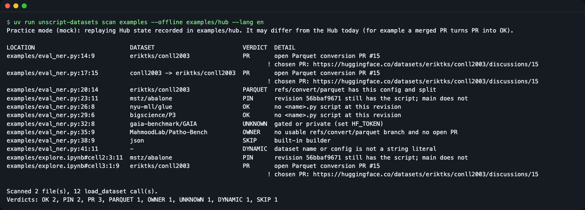
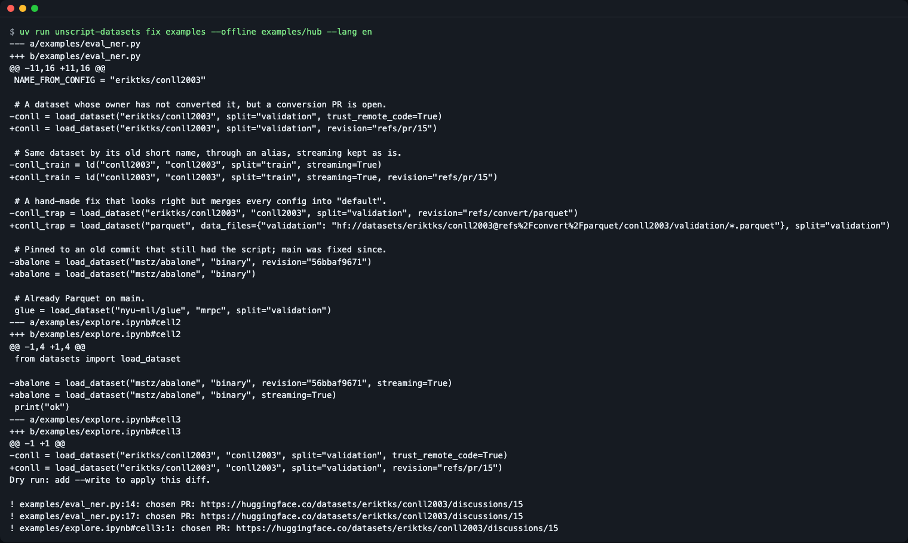
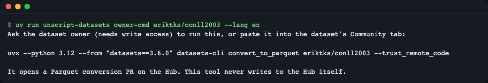
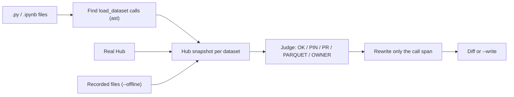

# unscript-datasets

**English** | [한국어](README.ko.md)

Your notebook or eval script stopped working after upgrading `datasets` to 4.x with `RuntimeError: Dataset scripts are no longer supported, but found <name>.py`. `unscript-datasets` scans your `.py` and `.ipynb` files for `load_dataset` calls, asks the Hugging Face Hub what state each dataset is in today, and rewrites the broken calls the way that dataset can actually be loaded now. Config and split names are kept, and the same input gives the same output every time.


*`scan` in practice (mock) mode: every `load_dataset` call gets a verdict such as PR, PARQUET, PIN, OK, OWNER or UNKNOWN.*

## Who it is for
- You upgraded `datasets` and a notebook, an evaluation script or CI job now fails at `load_dataset(...)`.
- You have dozens of `load_dataset` calls in a repo and do not want to check each dataset's Hub page by hand.
- You maintain a dataset and want the exact command that converts it to Parquet.

## Install
```bash
# uv (https://docs.astral.sh/uv/): curl -LsSf https://astral.sh/uv/install.sh | sh
uv tool install git+https://github.com/LeeGyeongPil/unscript-datasets
```
Requires Python 3.10+. The only runtime dependency is `huggingface_hub`; `datasets` itself is not needed.

To try it from a clone instead:
```bash
git clone https://github.com/LeeGyeongPil/unscript-datasets
cd unscript-datasets
uv sync
```
(then prefix the commands below with `uv run`).

## Quick start
This uses the practice (mock) mode: it replays Hub state recorded in `examples/hub` instead of calling the network, so the result is the same on every machine.
```bash
uv run unscript-datasets scan examples --offline examples/hub --lang en
```
```text
Practice mode (mock): replaying Hub state recorded in examples/hub. It may differ from the Hub today (for example a merged PR turns PR into OK).

LOCATION                           DATASET                         VERDICT  DETAIL
examples/eval_ner.py:14:9          eriktks/conll2003               PR       open Parquet conversion PR #15
                                                                          ! chosen PR: https://huggingface.co/datasets/eriktks/conll2003/discussions/15
examples/eval_ner.py:17:15         conll2003 -> eriktks/conll2003  PR       open Parquet conversion PR #15
                                                                          ! chosen PR: https://huggingface.co/datasets/eriktks/conll2003/discussions/15
examples/eval_ner.py:20:14         eriktks/conll2003               PARQUET  refs/convert/parquet has this config and split
examples/eval_ner.py:23:11         mstz/abalone                    PIN      revision 56bbaf9671 still has the script; main does not
examples/eval_ner.py:26:8          nyu-mll/glue                    OK       no <name>.py script at this revision
examples/eval_ner.py:29:6          bigscience/P3                   OK       no <name>.py script at this revision
examples/eval_ner.py:32:8          gaia-benchmark/GAIA             UNKNOWN  gated or private (set HF_TOKEN)
examples/eval_ner.py:35:9          MahmoodLab/Patho-Bench          OWNER    no usable refs/convert/parquet branch and no open PR
examples/eval_ner.py:38:9          json                            SKIP     built-in builder
examples/eval_ner.py:41:11         -                               DYNAMIC  dataset name or config is not a string literal
examples/explore.ipynb#cell2:3:11  mstz/abalone                    PIN      revision 56bbaf9671 still has the script; main does not
examples/explore.ipynb#cell3:1:9   eriktks/conll2003               PR       open Parquet conversion PR #15
                                                                          ! chosen PR: https://huggingface.co/datasets/eriktks/conll2003/discussions/15

Scanned 2 file(s), 12 load_dataset call(s).
Verdicts: OK 2, PIN 2, PR 3, PARQUET 1, OWNER 1, UNKNOWN 1, DYNAMIC 1, SKIP 1
```
The command exits with code 1 because some calls need fixing. For your own code, drop `--offline examples/hub` to ask the real Hub:
```bash
unscript-datasets scan path/to/your/project
```
The recorded state is from 2026-11-18 and can differ from the Hub today. A merged PR, for example, turns `PR` into `OK`.

## Usage

| Command | What it does | Example |
|---|---|---|
| `scan PATH...` | Lists every `load_dataset` call with a verdict | `unscript-datasets scan src notebooks` |
| `fix PATH...` | Prints a diff of the replacement code (dry run) | `unscript-datasets fix src` |
| `fix PATH... --write` | Applies the diff to the files | `unscript-datasets fix src --write` |
| `owner-cmd ID` | Prints the command a dataset owner runs to convert to Parquet | `unscript-datasets owner-cmd eriktks/conll2003` |
| `record ID...` | Saves the Hub state of datasets as snapshot files for `--offline`. A dataset the Hub did not answer for is not saved | `unscript-datasets record eriktks/conll2003 --out hub` |
| `--offline DIR` | Replays snapshots from `DIR` instead of asking the Hub | `scan examples --offline examples/hub` |
| `--exclude GLOB` | Skips extra paths (repeatable) | `scan . --exclude "build/*"` |
| `--json` (`scan`) | Machine-readable output sorted by file, line and column | `scan src --json` |
| `--strict` | Also exit 1 on `UNKNOWN` and `DYNAMIC` | `scan src --strict` |
| `--lang en\|ko` | Output language | `scan src --lang ko` |

Exit codes for `scan` and `fix`: `0` nothing to fix, `1` something to fix (`PIN`, `PR`, `PARQUET`, `OWNER`, `MANUAL`), `2` usage error such as a missing path or an unusable snapshot folder.

Exit codes for `record`: `0` everything recorded, `1` recorded with a warning (gated or missing dataset, unknown `--revision`), `2` the Hub did not answer for at least one dataset (that dataset is not saved). For example, with Hub access (the `!` line is on stderr, exit code 1):
```console
$ unscript-datasets record eriktks/conll2003 gaia-benchmark/GAIA --out hub --lang en
! gaia-benchmark/GAIA is gated or private and was recorded as 'gated'. Set HF_TOKEN to record its files.
Recorded eriktks/conll2003 -> hub/eriktks__conll2003.json (status: ok)
Recorded gaia-benchmark/GAIA -> hub/gaia-benchmark__GAIA.json (status: gated)
```

### Verdicts

| Verdict | Meaning | What `fix` does |
|---|---|---|
| `OK` | No `<name>.py` loading script at this revision | Nothing |
| `PIN` | `revision=` points to an old commit that still has the script; the default branch does not | Removes the `revision=` argument |
| `PR` | The owner has not converted the dataset, but a Parquet conversion PR is open | Adds `revision="refs/pr/<n>"` and removes `trust_remote_code` |
| `PARQUET` | A `refs/convert/parquet` branch has the config and split | Rewrites to `load_dataset("parquet", data_files=...)` keeping config and split |
| `OWNER` | No usable conversion branch and no open PR | Nothing; use `owner-cmd` and ask the owner |
| `MANUAL` | A rewrite is possible but not safe to generate (for example `data_files` already given) | Nothing |
| `UNKNOWN` | Gated, private, not recorded, or the Hub did not answer | Nothing; set `HF_TOKEN` or see [Troubleshooting](#troubleshooting) |
| `DYNAMIC` | Dataset name or config is not a string literal | Nothing |
| `SKIP` | Built-in builder (`json`, `csv`, ...) or a local path | Nothing |

### Preview the fix
```bash
uv run unscript-datasets fix examples --offline examples/hub --lang en
```

*`fix` prints a diff and changes nothing until you pass `--write`.*

Key lines of the output:
```diff
-conll = load_dataset("eriktks/conll2003", split="validation", trust_remote_code=True)
+conll = load_dataset("eriktks/conll2003", split="validation", revision="refs/pr/15")
-conll_trap = load_dataset("eriktks/conll2003", "conll2003", split="validation", revision="refs/convert/parquet")
+conll_trap = load_dataset("parquet", data_files={"validation": "hf://datasets/eriktks/conll2003@refs%2Fconvert%2Fparquet/conll2003/validation/*.parquet"}, split="validation")
-abalone = load_dataset("mstz/abalone", "binary", revision="56bbaf9671")
+abalone = load_dataset("mstz/abalone", "binary")
```
The second change is the one that is easy to get wrong by hand. `revision="refs/convert/parquet"` alone loads, but every config is merged into one called `default`, so `"conll2003"` is no longer found. The generated `data_files` call keeps the split.

Apply and re-check (shown on a throwaway copy of `examples/`; running it on the original changes those files, so try it on a copy. `--write` prints the diff first, so only the last lines of each command are shown):
```bash
unscript-datasets fix examples --offline examples/hub --lang en --write
unscript-datasets scan examples --offline examples/hub --lang en | tail -2
unscript-datasets fix examples --offline examples/hub --lang en --write
```
```text
# 1st command, last lines (after the diff; warnings such as "chosen PR" go to stderr):
Updated 2 file(s), 6 call(s).
1 call(s) still need a human or the dataset owner (OWNER/MANUAL).
# 2nd command (tail -2):
Scanned 2 file(s), 12 load_dataset call(s).
Verdicts: OK 7, OWNER 1, UNKNOWN 1, DYNAMIC 1, SKIP 2
# 3rd command:
Nothing to change.
1 call(s) still need a human or the dataset owner (OWNER/MANUAL).
```
After the fix, every PR, PARQUET and PIN call is OK. One OWNER call is left that only its owner can fix, so the exit code stays 1. The second `--write` changes nothing, so running it twice is safe. Only the text of each call is replaced: aliases such as `ld(...)`, `streaming=True` and other keywords are kept verbatim, and notebooks keep their other cells, outputs and metadata.

### Ask the dataset owner
For an `OWNER` dataset, only its owner can fix it. The command works for any script dataset; `eriktks/conll2003` is used here only as an example (the scan above judges it `PR`):
```bash
uv run unscript-datasets owner-cmd eriktks/conll2003 --lang en
```

*The command to hand to the dataset owner. The tool itself never writes to the Hub.*

```text
Ask the dataset owner (needs write access) to run this, or paste it into the dataset's Community tab:

uvx --python 3.12 --from "datasets==3.6.0" datasets-cli convert_to_parquet eriktks/conll2003 --trust_remote_code

It opens a Parquet conversion PR on the Hub. This tool never writes to the Hub itself.
```

### Does the fixed code really load?
Not re-run for this README. During development (2026-11-18, `datasets` 5.2.0), these were tried against the live Hub and recorded in the project's probe log (not published; the sources are listed under [Sources](#sources)):
- `load_dataset("eriktks/conll2003", split="validation")` fails with `Dataset scripts are no longer supported, but found conll2003.py`.
- With `revision="refs/pr/15"` the same call loads 3250 rows.
- The generated `data_files` call loads 3250 rows with class label names intact.
- `mstz/abalone` pinned to `56bbaf9671` fails; on the default branch it loads 4177 rows.

## Configuration
All settings are optional (see `.env.example`).

| Variable | Purpose |
|---|---|
| `HF_TOKEN` | Token for gated or private datasets; without it they are reported as `UNKNOWN` |
| `HF_ENDPOINT` | Hub endpoint override read by `huggingface_hub` (mirrors) |
| `UNSCRIPT_DATASETS_LANG` | UI language `en` or `ko`. Order: `--lang`, this variable, then `LC_ALL`/`LC_MESSAGES`/`LANG`; anything that is not Korean falls back to English |
| `SSL_CERT_FILE` | Troubleshooting only: CA bundle path when the system trust store is not usable |

Practice (mock) mode versus real mode: mock mode replays recorded snapshots, needs no network or token and is deterministic, but it shows the Hub as of recording time. Real mode asks the Hub for each distinct dataset, so it needs network access and can be slow for many datasets.

## How it works

- Calls are found with Python's `ast`, so aliases (`from datasets import load_dataset as ld`) and `datasets.load_dataset(...)` are handled. In notebooks, `!` and `%` lines are masked and line numbers are kept.
- The judge only sees a snapshot: the dataset's files, refs, open PRs and the `refs/convert/parquet` tree. Real and mock mode differ only in where the snapshot comes from.
- A call is flagged only when a file named `<repo name>.py` exists at the requested revision, which is the rule `datasets` itself uses. `bigscience/P3` has other `.py` files and is judged `OK`.
- The rewrite replaces only the call's byte span. If the result does not parse, the call is reported as `MANUAL` instead.

## When to use it
- Good fit: a handful to hundreds of `load_dataset` calls broken after the upgrade, where you want a repeatable, reviewable diff.
- Not a fit: you only need to know why the error appears (read the sources below), or the dataset is yours (use `owner-cmd` and convert it on the Hub).
- Alternative: pin `datasets<4` to keep scripts working, see the [datasets documentation](https://huggingface.co/docs/datasets). Caveat: the pin brings back remote code execution, which `datasets` 4.0.0 removed on purpose, and you miss later fixes and features. Use it only for code you trust, as a stop-gap.

## Limitations
- Only `load_dataset` is handled. Dynamic arguments (variables, f-strings) are reported as `DYNAMIC` but not traced.
- Calls that already pass `data_files` or `data_dir`, or have more than 5 positional arguments, are reported as `MANUAL` when a `PARQUET` rewrite would be needed; nothing is changed.
- It does not download data to check that the fixed call loads (a planned `--verify` option is not built). The results under "Does the fixed code really load?" come from a one-off manual probe.
- A verdict reflects the Hub at the moment you run it, and only open PRs are considered. The mock snapshots in `examples/hub` were recorded on 2026-11-18.
- A comment inside a rewritten call is lost; `fix` warns about it on stderr.
- `fix` and `owner-cmd` never write to the Hub.

## Sources
Checked 2026-11-18.
- Scripts removed in `datasets` 4.0.0: <https://github.com/huggingface/datasets/releases/tag/4.0.0>
- Error reports and discussions: <https://github.com/huggingface/datasets/issues/7693>, <https://github.com/huggingface/datasets/issues/8017>, <https://discuss.huggingface.co/t/cannot-load-conll2003/169142>, <https://discuss.huggingface.co/t/dataset-scripts-are-no-longer-supported/163891>
- Example conversion PR used in the demo: <https://huggingface.co/datasets/eriktks/conll2003/discussions/15>
- `refs/convert/parquet` branch and its merged `default` config: <https://huggingface.co/docs/dataset-viewer/parquet>, <https://discuss.huggingface.co/t/create-the-refs-convert-parquet-branch-of-a-script-based-dataset-to-get-the-viewer/100239>
- `convert_to_parquet` command: <https://huggingface.co/docs/datasets/main/en/cli> (version 3.6.0 as the last that ships it comes from the probe log above)

## Troubleshooting

| Symptom | Cause | Fix |
|---|---|---|
| With `--offline DIR`, a dataset shows `UNKNOWN  no recorded snapshot for this dataset` (`--json` reason: `not_recorded`) | `DIR` has no snapshot for that dataset | Record it with Hub access: `unscript-datasets record <id> --out DIR` |
| `UNKNOWN  gated or private (set HF_TOKEN)` | The dataset needs a token | `export HF_TOKEN=...` and run again |
| Real mode: every Hub call is `UNKNOWN  Hub not reachable (see README, Troubleshooting)`, and stderr says `! the Hub did not answer for N dataset(s) ... (ConnectError: ('OSStatus -26276',))` or another SSL error | Python cannot use the system trust store (macOS, some sandboxes) | Point it at a CA bundle: `SSL_CERT_FILE=/etc/ssl/cert.pem unscript-datasets scan ...` |
| Same `Hub not reachable` rows, but the stderr cause is not an SSL error | No network to the Hub (proxy, firewall), a wrong `HF_ENDPOINT`, or `HF_HUB_OFFLINE` is set | Fix the connection or the variable. The exit code stays 0 for `UNKNOWN`; in CI add `--strict` so it exits 1 instead of passing silently |
| `record` prints `error: could not record <id>: the Hub did not answer (...). Nothing was written for it.` and exits 2 | Same causes as the two rows above | Same fixes, then run `record` again. An existing snapshot for that dataset is left as it was |
| `error: snapshot recorded without a Hub answer: DIR/<file>.json (status: network)` and exit 2 | The file was written without a Hub answer (for example edited by hand or copied from elsewhere) | Delete the file and record it again with Hub access |
| Output is Korean on an English setup | `LANG` is Korean | `--lang en` or `UNSCRIPT_DATASETS_LANG=en` |
| Exit code 1 in CI | Something still needs fixing | Expected; see the verdicts, use `--json` for details |

## Development
```bash
uv run pytest -q
```
85 tests pass; they run without network access. Bugs and ideas are welcome as issues. Changes are listed in [CHANGELOG.md](CHANGELOG.md).

## License
MIT.
